<div align="center">


# Relay

**Self-hostable, multi-tenant webhooks-as-a-service, built on Postgres alone.**

Your backend publishes an event once. Relay signs it, fans it out to every subscriber, retries with jittered backoff, trips circuit breakers on endpoints that keep failing, and records every attempt.

[](backend/pyproject.toml)
[](https://fastapi.tiangolo.com)
[](https://docs.pydantic.dev)
[](https://www.postgresql.org)
[](web/package.json)
[](web/tsconfig.json)
[](backend/pyproject.toml)
[](https://www.standardwebhooks.com)
[](.github/workflows/ci.yml)
[](LICENSE)

[Why](#why-this-exists) · [Features](#feature-highlights) · [Screenshots](#screenshots) · [Architecture](#architecture) · [Quickstart](#quickstart) · [API](#api-overview) · [Decisions](#engineering-decisions-and-trade-offs)

<br />

<picture>
  <source media="(prefers-color-scheme: dark)" srcset="docs/screenshots/overview-dark.png" />
  <source media="(prefers-color-scheme: light)" srcset="docs/screenshots/overview-light.png" />
  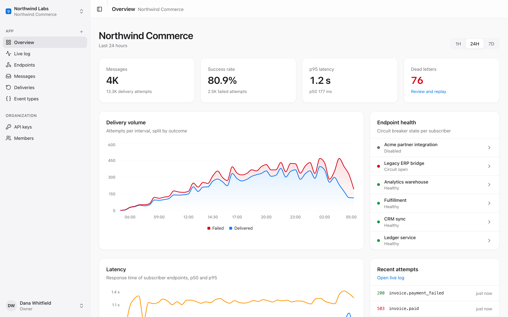
</picture>

</div>

## Why this exists

Every SaaS product eventually has to send webhooks, and the first version is usually `requests.post()` inside a request handler. Then the problems arrive. Events are lost when the process crashes between the database commit and the HTTP call. One slow customer endpoint ties up every worker. Retries hammer a receiver that is already down. Nobody can answer "did we send it, and what did they reply?"

Relay solves these with a small set of well-understood patterns and no message broker:

| Problem | How Relay handles it |
| --- | --- |
| Lost or half-sent events | **Transactional outbox.** The message and one delivery row per subscribed endpoint commit in the same transaction as validation. |
| Duplicate publishes from client retries | **`Idempotency-Key`** with a request fingerprint. A repeat returns the original message, and a different body under the same key returns `409`. |
| Crashed workers | **Leases with fencing tokens.** `SELECT … FOR UPDATE SKIP LOCKED` claims work. An expired lease is reclaimed, and a stale owner cannot overwrite the new owner's result. |
| Thundering-herd retries | **Exponential backoff with full jitter**, which honors `Retry-After`, then a dead-letter state with single and bulk replay. |
| One broken receiver hurting everyone | **Per-endpoint circuit breaker** (closed → open → half-open probe), automatic disabling after repeated trips, and a **GCRA token-bucket rate limit** enforced when work is leased. |
| "Is this request really from you?" | **[Standard Webhooks](https://www.standardwebhooks.com) signatures** (HMAC-SHA256) with secret rotation. During the overlap window Relay signs with both secrets. |
| "What happened to event X?" | Every attempt is stored with status, latency and a response snippet, then streamed live to the console over **SSE backed by `LISTEN/NOTIFY`**. |

A bundled **chaos receiver** returns 500s, timeouts, slow responses, `Retry-After` and `410 Gone` on demand, so you can watch these mechanisms work.

## Feature highlights

**Delivery engine**
- Event ingestion with a per-app **event-type registry**. Payloads are validated against the type's **JSON Schema (Draft 2020-12)**, and compiled validators are cached per schema version.
- Fan-out to endpoints filtered by event type. Disabled and soft-deleted endpoints are skipped.
- Each dispatcher process runs **N async workers**, and you can run any number of processes. Workers wake on `NOTIFY` and poll as a fallback.
- Signed envelope `{"type", "timestamp", "data"}` with `webhook-id`, `webhook-timestamp` and `webhook-signature: v1,<base64>` headers.
- Retry policy: 5 s base, doubling, capped at 1 h, at most 8 attempts, `Retry-After` honored up to 1 h. A `410 Gone` disables the endpoint and dead-letters the delivery immediately.
- Circuit breaker: opens after 5 consecutive failures, with a cooldown that starts at 30 s and doubles up to 15 min. One half-open probe is allowed at a time, and the endpoint is auto-disabled after 8 trips. While the breaker is open, deliveries are parked rather than counted as failed attempts.
- **SSRF guard**: in production, outbound connections resolve the host and dial only public addresses. The check happens at connect time, which defeats DNS rebinding.

**Multi-tenancy and auth**
- `org → app → endpoint` hierarchy, with every query scoped by tenant.
- **API keys** (`rk_…`) stored as peppered HMAC-SHA256 hashes, with scopes, expiry and revocation. **Passwords** use argon2.
- **JWT console sessions** in an `httpOnly` cookie. The Next.js server proxies every API call, so the browser never sees a token.
- **RBAC** with four roles (owner, admin, developer, viewer) mapped to 11 scopes. Users can only assign roles below their own, except the owner.
- Per-account and per-client login throttling.

**Operator console** (Next.js 15, shadcn/ui, Recharts, TanStack Query)
- Overview with message volume, success rate, p50/p95 latency, dead-letter count, delivery volume, and breaker state for each endpoint.
- **Live log** over SSE, with pause and resume, an endpoint filter, and click-through to the attempt timeline.
- Endpoint detail with latency and success-rate charts, signing-secret reveal and rotation, enable/disable, circuit reset and dead-letter replay.
- Message browser, a **Send test event** dialog pre-filled from the JSON Schema, event-type catalog, API keys and members.
- Light and dark mode with an Apple-inspired visual language.

## Screenshots

**Live log.** Every attempt as it happens, streamed from Postgres `LISTEN/NOTIFY`.

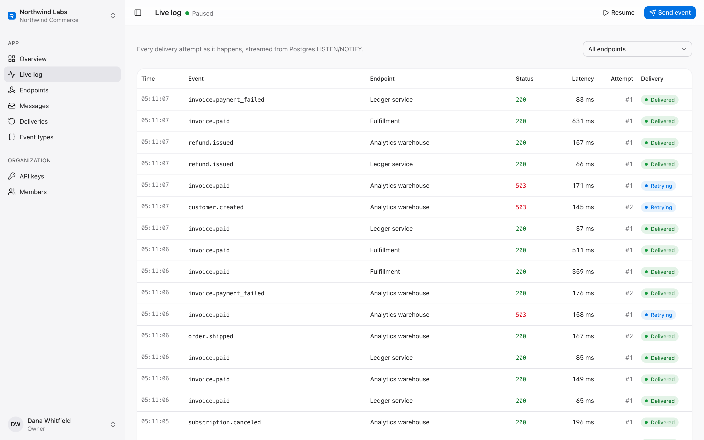

**Circuit open.** Consecutive failures, trip count, the next half-open probe and a one-click reset.

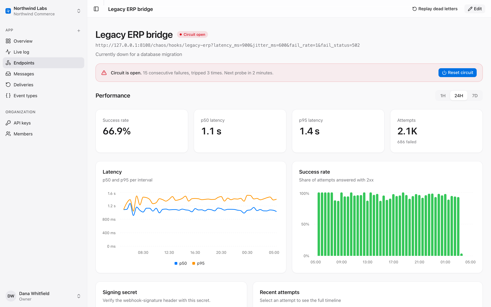

**Attempt timeline.** Status, latency, retry schedule and response snippet for each of the 8 attempts.

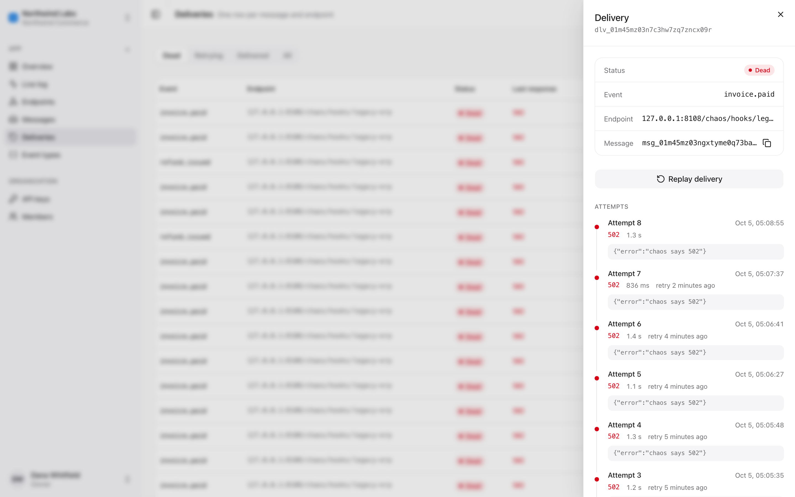

**Dead letters.** Deliveries that exhausted their retries, replayable one at a time or all at once.

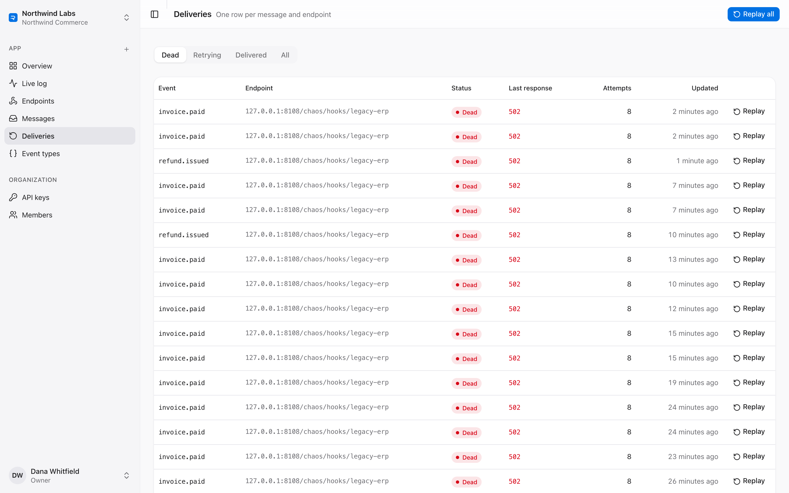

**Endpoint health.** p50/p95 latency, success rate, signing secret rotation, rate limit and timeout.

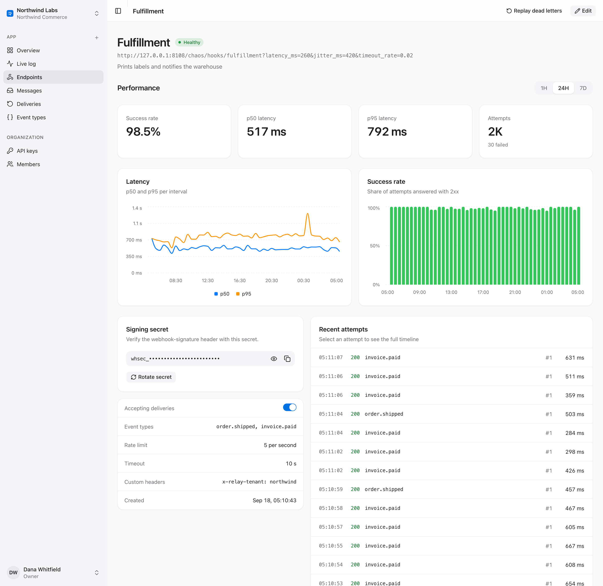

**Send test event.** A payload generated from the event type's JSON Schema, validated before fan-out.

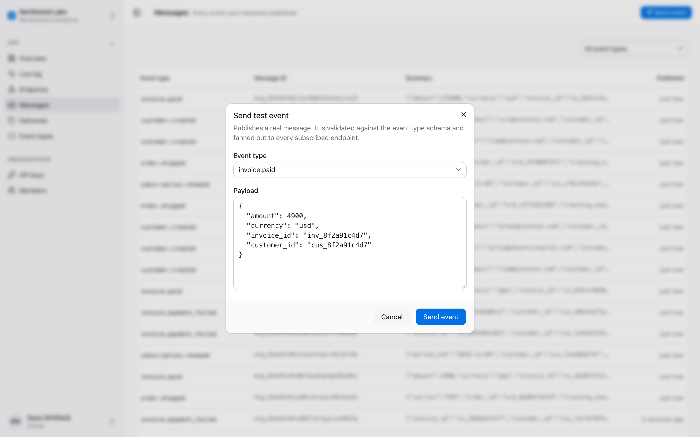

**Event types.** The versioned schema catalog that payloads are validated against.

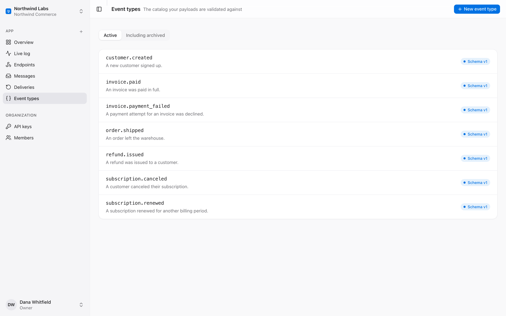

**Members.** Owner, admin, developer and viewer roles mapped to scopes.

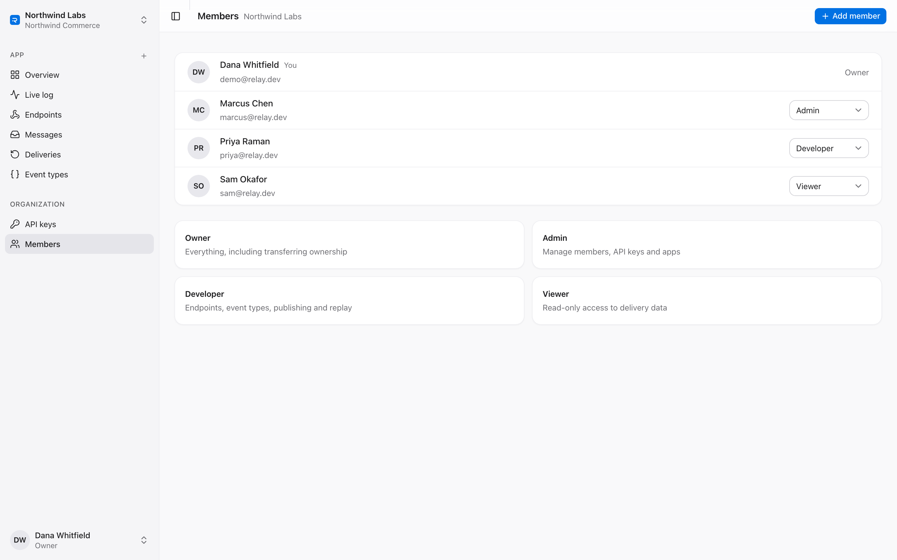

## Architecture

The backend ships as one Python package with three entrypoints, `relay-api`, `relay-dispatcher` and `relay-chaos`, plus `relay-seed` for demo data. Postgres is the only stateful component. It serves as the system of record, the work queue and the pub/sub bus.

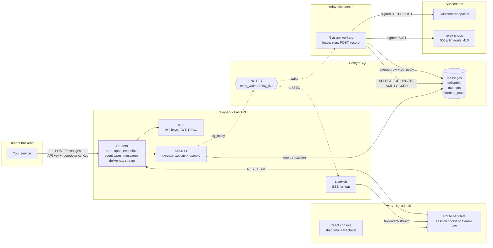

### Core flow: publish, then deliver

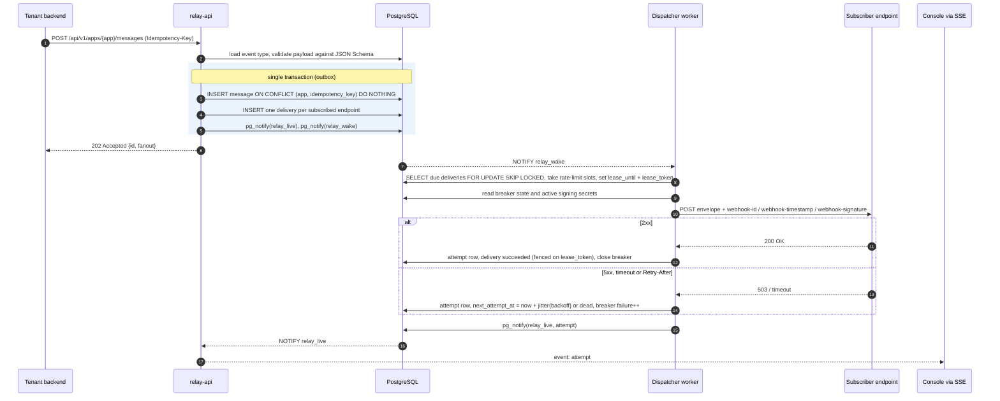

### Delivery lifecycle

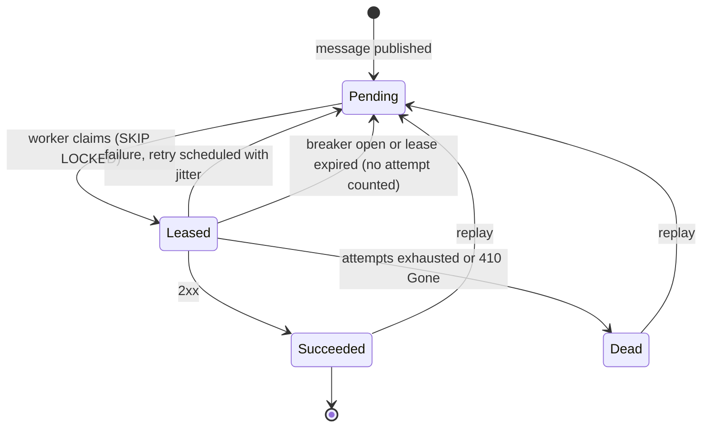

### Circuit breaker

The breaker is a pure state machine in `domain/breaker.py`. The dispatcher loads the persisted snapshot, passes it through the transition functions, and writes it back under a row lock, so all dispatcher processes see one consistent breaker per endpoint.

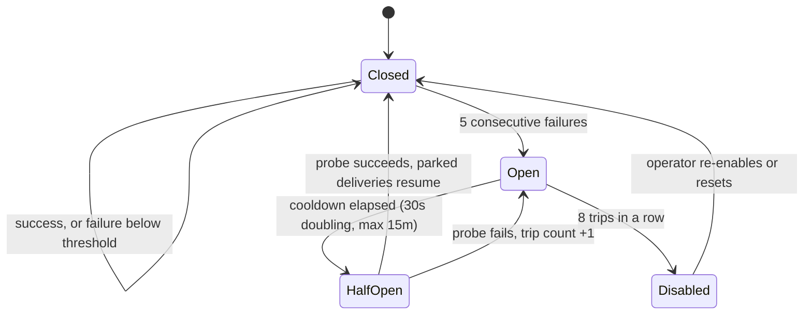

### Console user flow

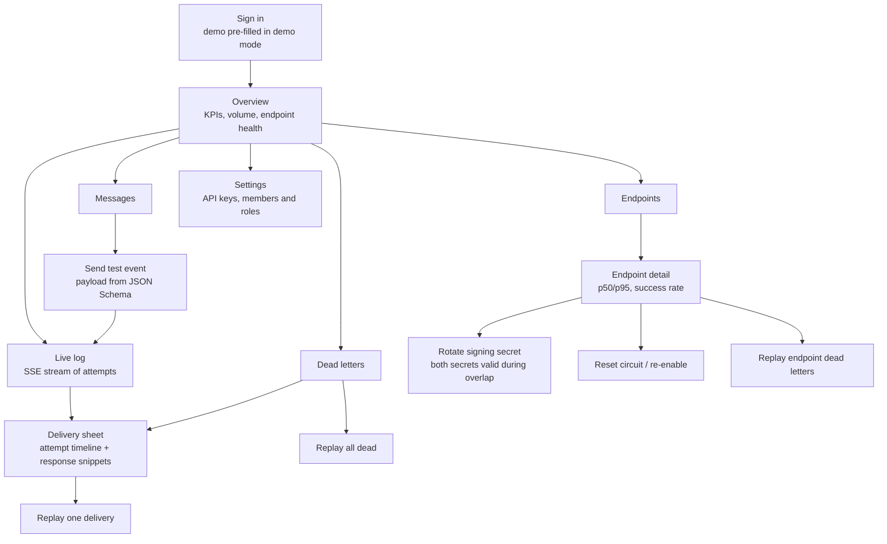

### Data model

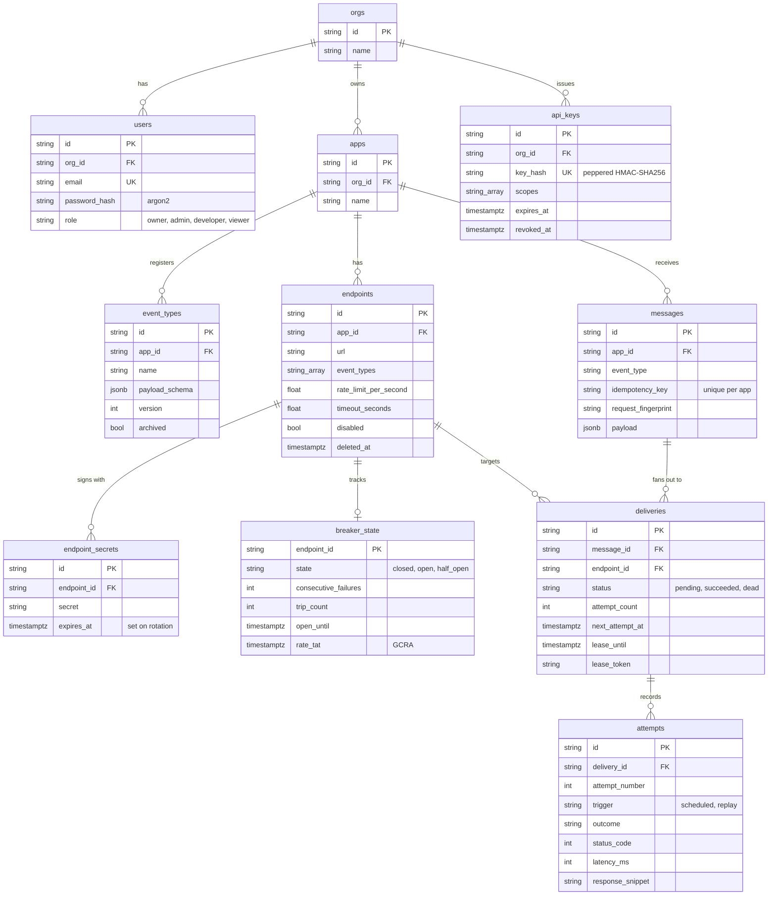

## Tech stack

| Layer | Technology | Notes |
| --- | --- | --- |
| API | **FastAPI**, Uvicorn | Typed routers, dependency-injected `Principal` with scope checks, uniform error envelope |
| Models and config | **Pydantic v2**, pydantic-settings | Separate input and output models, `RELAY_*` settings that refuse unsafe production configurations |
| Persistence | **SQLAlchemy 2.0 async**, asyncpg, **Alembic** | Repositories, partial indexes for the due queue and idempotency |
| Database | **PostgreSQL 16+** | `FOR UPDATE SKIP LOCKED`, `LISTEN/NOTIFY`, JSONB, arrays |
| Delivery | **httpx** (streaming) | Overall deadline per attempt, capped response snippet, public-only transport |
| Validation | **jsonschema** | Draft 2020-12 with format checking, LRU of compiled validators, runs off the event loop |
| Live updates | **sse-starlette** | One `LISTEN` connection per process with bounded queues per subscriber |
| Auth | **PyJWT**, **argon2-cffi** | Session JWTs, argon2 passwords, peppered API-key hashes |
| Logging | structlog | JSON logs in compose |
| Console | **Next.js 15** App Router, **TypeScript strict**, **shadcn/ui**, Tailwind v4 | Server-side proxy route handlers, middleware session gate |
| Data and charts | **TanStack Query**, **Recharts**, zod | Every API response is parsed with a zod schema |
| Tests | **pytest**, pytest-asyncio, **testcontainers**, Vitest | Real Postgres for integration tests |
| Quality | ruff, **mypy --strict**, ESLint, `tsc --noEmit` | Enforced in CI |
| Ops | Docker Compose, GitHub Actions | Postgres, migrate, API, dispatcher, chaos, console |

## Engineering decisions and trade-offs

<details open>
<summary><b>Postgres as the queue instead of Kafka, RabbitMQ or Redis</b></summary>

The outbox guarantee depends on the event and its deliveries committing atomically with the API's decision to accept them. With an external broker that needs a relay process and a second source of truth. Putting the queue in Postgres removes the dual-write problem. `SKIP LOCKED` lets many workers lease disjoint rows without blocking each other, and a partial index on `next_attempt_at WHERE status = 'pending'` keeps the due-work scan small. **Trade-off:** throughput is limited by one primary's write capacity, which covers far more traffic than most webhook senders produce. Partitioning `attempts` by time would be the next step.
</details>

<details>
<summary><b>Leases with fencing tokens, not row locks held across the HTTP call</b></summary>

Holding a transaction open during a 15-second webhook call would pin a connection and its locks for each in-flight request. Instead, a worker claims rows in a short transaction and stamps `lease_until` and a random `lease_token`. Every write-back has the condition `WHERE lease_token = :mine`. If a worker stalls past its lease and another worker re-leases the row, the stale worker's attempt is still kept in the audit trail, but it cannot change the delivery state or the breaker. Settings validation requires the lease to outlive the longest timeout an endpoint can configure.
</details>

<details>
<summary><b>At-least-once delivery, and receivers deduplicate</b></summary>

Exactly-once over HTTP is impossible: a receiver can process a request and crash before replying. Relay delivers at least once and keeps `webhook-id` stable (it is the message id) across retries and replays, which is the deduplication key the Standard Webhooks spec gives receivers.
</details>

<details>
<summary><b>Full-jitter backoff that respects Retry-After</b></summary>

The delay is `uniform(0, min(cap, base * 2^n))`, the "full jitter" variant from AWS's analysis, which spreads retries from many failed deliveries instead of synchronizing them. When the receiver sends `Retry-After` (seconds or an HTTP date), Relay waits at least that long, capped so a hostile header cannot park a delivery forever. The policy is a pure function and is unit-tested with a seeded RNG.
</details>

<details>
<summary><b>The breaker is enforced at lease time, not after</b></summary>

The candidate query excludes endpoints whose breaker is open, whose half-open probe is still in flight, or whose GCRA rate budget is used up. A backlog for one sick endpoint therefore never occupies workers or churns rows while healthy endpoints wait (there is an integration test for this). Parked deliveries are released without counting an attempt, so an outage does not consume a delivery's retry budget.
</details>

<details>
<summary><b>GCRA for rate limiting</b></summary>

A token bucket written as a single timestamp, the theoretical arrival time, fits in one column of `breaker_state` and updates under the same row lock from any number of dispatchers. A separate token count and refill timer would not.
</details>

<details>
<summary><b>Signing secrets are stored, API keys are hashed</b></summary>

HMAC signing needs the raw secret, so endpoint secrets are stored as-is and only revealed to authorized users. API keys are 192-bit random tokens, so a peppered SHA-256 is enough at rest and keeps lookups to one indexed equality match. Passwords are low-entropy and use argon2.
</details>

<details>
<summary><b>Backend-for-frontend console</b></summary>

The browser talks only to Next.js route handlers. The session JWT lives in an `httpOnly`, `SameSite=Lax` cookie and is converted to a Bearer header on the server, so no token reaches client JavaScript and the API needs no permissive CORS for the console. SSE is streamed through the same proxy.
</details>

## Project structure

```text
relay-webhooks/
├── backend/
│   ├── alembic/versions/          # 0001 initial schema, 0002 pacing + soft delete
│   ├── src/relay/
│   │   ├── api/                   # FastAPI app, deps (Principal, scopes), routes/, error envelope
│   │   ├── auth/                  # api_keys, passwords (argon2), tokens (JWT), rbac, login throttle
│   │   ├── chaos/                 # unreliable receiver: fail_rate, timeout_rate, latency, retry_after, gone
│   │   ├── delivery/client.py     # httpx sender, overall deadline, SSRF-safe transport
│   │   ├── dispatcher/            # runner (N workers, NOTIFY wake) + processor (breaker, sign, record)
│   │   ├── domain/                # Pydantic models, enums, breaker, retry, pacing (pure functions)
│   │   ├── events/                # pg_notify publisher, LISTEN hub, SSE fan-out
│   │   ├── persistence/           # tables, outbox, queue (lease/fence/replay), repositories/
│   │   ├── services/              # catalog, messages, stats, schema validation, tenant access
│   │   ├── signing/               # Standard Webhooks sign + verify (multi-secret)
│   │   ├── config.py              # pydantic-settings, production guards
│   │   └── seed.py                # demo tenant, 24h of history, traffic generator
│   └── tests/
│       ├── unit/                  # signing, retry, breaker, pacing, SSRF, chaos, throttle, config
│       └── integration/           # outbox, queue, dispatcher, breaker, API, SSE (real Postgres)
├── web/
│   └── src/
│       ├── app/(auth)/            # login, signup
│       ├── app/(console)/         # overview, live, endpoints, messages, deliveries, event-types, settings
│       ├── app/api/               # session routes + /api/relay/[...path] proxy
│       ├── components/            # charts, delivery sheet, dialogs, shell, shadcn/ui
│       └── lib/                   # zod API schemas, query hooks, SSE client, formatting
├── docs/screenshots/
├── docker-compose.yml
├── Makefile
└── .github/workflows/ci.yml
```

## Quickstart

### Local, without Docker

Requires Python 3.12+, Node 20+, pnpm 9 and a PostgreSQL 16+ server binary (Homebrew `postgresql@17` is detected automatically).

```bash
make install    # backend/.venv + pnpm install
make db         # Postgres on :5508, data in .data/pg
make seed       # migrate, then load the demo tenant with 24h of history
make dev        # API :8108 (chaos receiver at /chaos), dispatcher, console :3108
make traffic    # optional: a steady stream of demo events for the live log
```

Open **http://localhost:3108** and sign in with `demo@relay.dev` / `relay-demo-password`. The form is pre-filled in demo mode. `make db-stop` stops Postgres.

The seed creates the *Northwind Commerce* app with seven event types and six endpoints, each pointing at a different chaos profile: a healthy ledger, a flaky CRM, an analytics warehouse that sends `503` with `Retry-After`, a rate-limited fulfillment service, a legacy ERP that is down with its circuit open, and a partner endpoint disabled by `410 Gone`. It also creates an API key and prints it.

### Docker Compose

```bash
make up         # build, start postgres + migrate + api + dispatcher + chaos + web, then seed
make down
```

In compose the chaos receiver is its own service at `http://chaos:9000`, and the console sets `RELAY_SECURE_COOKIES=false` so sign-in works over plain http.

### Publish your first event

```bash
curl -X POST http://localhost:8108/api/v1/apps/$APP_ID/messages \
  -H "Authorization: Bearer $RELAY_API_KEY" \
  -H "Content-Type: application/json" \
  -H "Idempotency-Key: order-1042-shipped" \
  -d '{"event_type": "order.shipped", "payload": {"order_id": "ord_1042", "carrier": "ups", "tracking_number": "1Z999"}}'
```

### Verify on the receiving side

```python
from relay.signing import Webhook, WebhookVerificationError

wh = Webhook(["whsec_new...", "whsec_old..."])  # accept both during a rotation
try:
    wh.verify(request_body, request_headers)    # checks the timestamp window (5 min) and the v1 signature
except WebhookVerificationError:
    return 401
```

The headers follow the Standard Webhooks spec, so any of its official libraries can verify Relay's signatures as well.

## Configuration

Backend settings come from the environment with the `RELAY_` prefix, or from `.env` (see [`.env.example`](.env.example)).

| Variable | Default | Purpose |
| --- | --- | --- |
| `RELAY_ENV` | `development` | `production` enables secret-strength checks, refuses the chaos mount and blocks private endpoint IPs |
| `RELAY_DATABASE_URL` | `postgresql+asyncpg://relay@127.0.0.1:5508/relay` | Postgres DSN |
| `RELAY_API_HOST` / `RELAY_API_PORT` | `127.0.0.1` / `8108` | API bind address |
| `RELAY_CORS_ORIGINS` | `["http://localhost:3108"]` | Allowed browser origins |
| `RELAY_JWT_SECRET` | dev value | Session signing key, at least 32 bytes in production |
| `RELAY_JWT_TTL_MINUTES` | `720` | Console session lifetime |
| `RELAY_API_KEY_PEPPER` | dev value | Pepper for API-key hashes, at least 32 bytes in production |
| `RELAY_LOGIN_ATTEMPTS_PER_MINUTE` | `10` | Per-account login throttle |
| `RELAY_LOGIN_ATTEMPTS_PER_MINUTE_PER_CLIENT` | `60` | Per-client login throttle |
| `RELAY_DISPATCHER_WORKERS` | `16` | Concurrent workers per dispatcher process |
| `RELAY_DISPATCHER_LEASE_SECONDS` | `60` | Lease length; must outlive the maximum endpoint timeout |
| `RELAY_DELIVERY_TIMEOUT_SECONDS` | `15` | Default per-attempt deadline |
| `RELAY_RETRY_BASE_SECONDS` / `RELAY_RETRY_MAX_BACKOFF_SECONDS` | `5` / `3600` | Backoff base and cap |
| `RELAY_RETRY_MAX_ATTEMPTS` | `8` | Attempts before a delivery goes dead |
| `RELAY_RETRY_AFTER_CAP_SECONDS` | `3600` | Upper bound on an honored `Retry-After` |
| `RELAY_BREAKER_FAILURE_THRESHOLD` | `5` | Consecutive failures that open the breaker |
| `RELAY_BREAKER_BASE_COOLDOWN_SECONDS` / `RELAY_BREAKER_MAX_COOLDOWN_SECONDS` | `30` / `900` | Open-state cooldown, doubling per trip |
| `RELAY_BREAKER_DISABLE_AFTER_TRIPS` | `8` | Trips before the endpoint is auto-disabled |
| `RELAY_SECRET_ROTATION_OVERLAP_SECONDS` | `86400` | How long the previous secret keeps signing after rotation |
| `RELAY_ALLOW_PRIVATE_ENDPOINTS` | unset | Unset means allowed in dev/test and refused in production |
| `RELAY_CHAOS_MOUNT` / `RELAY_CHAOS_VERIFY_SECRET` | `false` / unset | Mount the chaos receiver at `/chaos` and verify signatures with this secret |
| `RELAY_LOG_JSON` / `RELAY_LOG_LEVEL` | `false` / `INFO` | structlog output |
| `RELAY_TEST_DATABASE_URL` | unset | Run integration tests against an existing database instead of a testcontainer |

Console (`web/`):

| Variable | Purpose |
| --- | --- |
| `RELAY_API_URL` | Where the Next.js server proxies API calls (server-side only) |
| `RELAY_SECURE_COOKIES` | Defaults to `true` in production builds; set `false` when served over plain http |
| `NEXT_PUBLIC_DEMO_MODE` | Pre-fills the sign-in form with the seeded demo account (build-time) |

## Testing

```bash
make lint typecheck                 # ruff + ESLint, mypy --strict + tsc --noEmit
make test-unit                      # pure domain tests, no database
make test-backend                   # integration tests in a Postgres testcontainer (needs Docker)
make test-backend USE_LOCAL_PG=1    # same suite against the `make db` server
make test-web                       # Vitest
make build                          # production console build
```

The backend has 74 test functions, and the integration tests run against a real PostgreSQL. Some of them:

| Area | What is proven |
| --- | --- |
| Outbox | Message and deliveries roll back together. Concurrent publishes with one `Idempotency-Key` create exactly one message. Reusing a key with a different body conflicts. Fan-out respects event filters and disabled endpoints. |
| Queue | Concurrent workers never lease the same delivery. An expired lease is reclaimed and the stale owner is fenced out. Only due deliveries on healthy endpoints are leased. |
| Dispatcher | Successful deliveries are signed and recorded. Failures follow the backoff schedule and then dead-letter. `Retry-After` is honored. `410` disables the endpoint. Rotation signs with both secrets during the overlap. A rate-limited backlog does not hold up other endpoints. |
| Breaker | It opens, parks traffic, probes and recovers. Repeated trips auto-disable the endpoint, and re-enabling resets it. Healthy traffic does not rewrite the breaker row. |
| API and auth | Signup, login and `/me` work. Tenants are isolated. Role and API-key scopes are enforced. Expired keys stop working. Login is throttled. |
| Live | `NOTIFY` reaches only matching subscribers and only on commit. SSE works over real HTTP. |

Unit tests cover the Standard Webhooks implementation (including multi-signature and timestamp tolerance), the retry schedule, breaker transitions, GCRA pacing, the SSRF resolver, the chaos receiver and settings guards. CI runs everything against a `postgres:16-alpine` service container, then builds the Docker images.

## API overview

All routes are under `/api/v1` and require `Authorization: Bearer <api key | session JWT>`. OpenAPI docs are served at `http://localhost:8108/docs`.

| Method and path | Scope | Description |
| --- | --- | --- |
| `POST /auth/signup`, `POST /auth/login`, `GET /auth/me` | none or session | Create an org and owner, sign in, current principal |
| `GET/POST /members`, `PATCH /members/{id}` | `apps:read` to list, `members:manage` to change | Add users and change roles |
| `GET/POST /api-keys`, `DELETE /api-keys/{id}` | `api_keys:manage` | Scoped API keys (plaintext shown once) |
| `GET/POST /apps`, `GET/PATCH/DELETE /apps/{app}` | `apps:*` | Apps within the org |
| `GET /apps/{app}/stats?window=1h\|24h\|7d` | `apps:read` | Volume, success rate, p50/p95, per-endpoint health |
| `GET/POST /apps/{app}/event-types`, `GET/PATCH/DELETE …/{name}` | `event_types:*` | Schema registry; editing a schema bumps its version |
| `GET/POST /apps/{app}/endpoints`, `GET/PATCH/DELETE …/{id}` | `endpoints:*` | Subscribers with filters, rate limit, timeout and headers; delete is soft |
| `POST …/endpoints/{id}/enable` | `endpoints:write` | Re-enable and close the breaker |
| `GET …/endpoints/{id}/secret`, `POST …/secret/rotate` | `endpoints:*` | Reveal or rotate the signing secret (`overlap_seconds` is optional) |
| `GET …/endpoints/{id}/stats` | `endpoints:read` | Latency and success-rate series |
| `POST …/endpoints/{id}/replay` | `deliveries:replay` | Replay that endpoint's dead letters |
| `POST /apps/{app}/messages` | `messages:write` | Publish (`Idempotency-Key` header). Returns `202`, or `200` with `idempotent-replayed: true` for a repeat |
| `GET /apps/{app}/messages`, `GET …/{id}` | `messages:read` | Cursor-paginated list, detail with deliveries |
| `GET /apps/{app}/deliveries`, `GET …/{id}` | `messages:read` | Filter by status or endpoint; detail includes attempts |
| `POST /apps/{app}/deliveries/{id}/replay` | `deliveries:replay` | Replay one delivery |
| `POST /apps/{app}/deliveries/replay` | `deliveries:replay` | Bulk replay by status, endpoint and time range |
| `GET /apps/{app}/attempts` | `messages:read` | Attempt log (backfills the live view) |
| `GET /apps/{app}/stream` | `messages:read` | SSE: `message` and `attempt` events |
| `GET /healthz` | none | Database check and live subscriber count |

The chaos receiver (`/chaos` when mounted, or `relay-chaos` on :9000) exposes `POST /hooks/{name}?fail_rate=&fail_status=&timeout_rate=&latency_ms=&jitter_ms=&retry_after=&gone=`, a `GET /inbox` of what it received along with each signature check, and `PUT/DELETE /control/scenarios/{name}` to stage an outage at runtime.

## Roadmap

- [ ] Time-partitioned `attempts` with a retention policy
- [ ] Per-endpoint transformations and payload filtering
- [ ] OpenTelemetry traces across ingest, lease and send
- [ ] Customer-facing embeddable portal (scoped tokens per subscriber)
- [ ] Prometheus metrics for queue depth, lease age and breaker state
- [ ] mTLS and static egress IPs for endpoints that require allow-listing

## License

[MIT](LICENSE)
